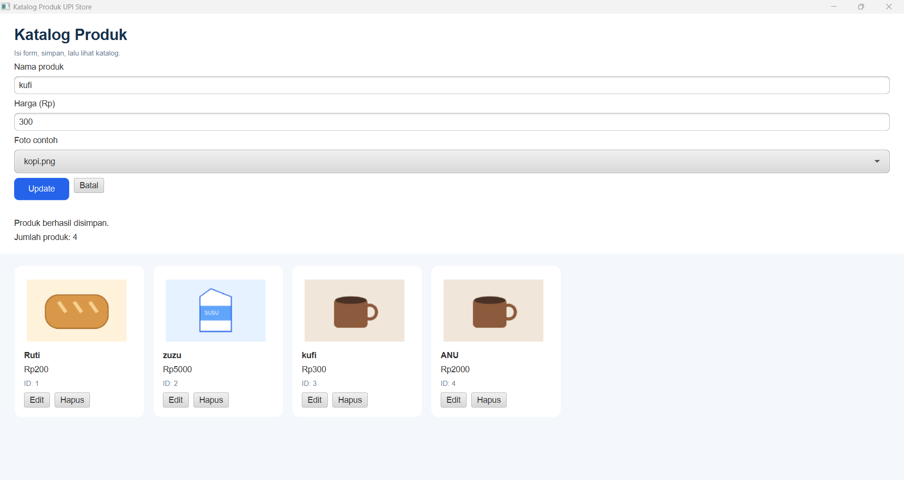

# Katalog Produk — UPI Store

Aplikasi desktop berbasis antarmuka grafis (GUI) untuk mengelola data katalog produk secara sederhana. Proyek ini dibuat untuk memenuhi tugas mata kuliah **Pemrograman Lanjut (Promlan)**.

## 🛠️ Teknologi yang Digunakan

* **Bahasa Pemrograman:** Java (JDK 8 atau versi lebih baru)
* **GUI Framework:** Java Swing
* **Penyimpanan Data:** In-Memory (`ArrayList`) *(sesuaikan jika menggunakan database seperti MySQL/SQLite)*

## ✨ Fitur Utama

* **Tambah & Simpan Produk:** Menambahkan item baru dengan memasukkan nama produk, harga (Rp), serta memilih gambar melalui menu dropdown (`Foto contoh`).
* **Tampilan Katalog (Card View):** Menampilkan seluruh daftar produk dalam bentuk kartu (*card*) yang memuat gambar, nama produk, harga, dan ID produk.
* **Edit / Update Produk:** Memperbarui data produk yang sudah tersimpan langsung melalui formulir utama.
* **Hapus Produk:** Menghapus item produk tertentu dari daftar katalog.
* **Notifikasi & Penghitung Otomatis:** Menampilkan pesan status saat data berhasil disimpan serta menghitung total jumlah produk yang tersedia secara *real-time*.

## 🚀 Cara Menjalankan Aplikasi

### Prasyarat
Pastikan **Java Development Kit (JDK)** sudah terinstal di perangkat Anda. Anda dapat mengeceknya melalui terminal/CMD dengan perintah:
```bash
java -version
```

## Tampilan UI
